# VenueIQ

**Smart Venue Operations**

**AI-first operations platform for timed and serviced venues — billiards clubs, KTV and board-game lounges.**

[中文说明](README.zh-CN.md) · [Architecture](docs/architecture/overview.md) · [Use cases](docs/architecture/use-cases.md) · [Quickstart](docs/guides/quickstart.md) · [API](docs/reference/api.md)

[](https://github.com/dengyouming163/billiards-ai/actions/workflows/agent-ci.yml)
[](https://github.com/dengyouming163/billiards-ai/actions/workflows/web-ci.yml)
[](LICENSE)

---

## Why this project exists

A multi-venue operator often runs billiards clubs, KTV rooms and board-game lounges on the same
books: money is earned by time (table fee, room fee), by people (assistant and service fees) and by
goods (drinks, tea, snacks), and each stream is settled separately. At shift handover the manager
needs three things at once: numbers that are exactly right, an explanation of what went wrong, and
the standard procedure that says what to do about it.

Most "AI features" in this space put all three in a chat box. This project separates them on purpose:

| Requirement | How it is met | What the model may do |
| --- | --- | --- |
| Numbers must be exact | Deterministic rules compare the shift snapshot with recomputed evidence | Nothing |
| Data must not change | SQL AST allowlist + read-only account + row and time limits | Propose a query, which is then guarded |
| Procedures must be cited | Hybrid retrieval with tenant and document ACL | Answer, but only with chunks it actually retrieved |

If the model is slow, wrong or unavailable, the report is still produced. It is marked `degraded`
and the explanation area says so — the figures never change.

## Use cases

| Venue type | Time fee | Service fee | Goods fee | Prepaid and cards | Reconciliation focus |
| --- | --- | --- | --- | --- | --- |
| Billiards club | Table fee by hour, package or member rate | Assistant coaching fee, timed share | Drinks, cues, snacks | Stored value, session cards | Table hours × rate, assistant order count |
| KTV / karaoke box | Room fee by session, often tied to a minimum spend | Service fee per head, room service staff | Drinks, fruit platters, snacks | Stored value, bottle keep | Room hours, minimum-spend top-up, headcount |
| Board-game lounge | Table fee by hour or flat package | Service fee, companion play | Tea, snacks | Stored value, monthly card | Package time attribution, tea add-ons, card deduction |

All three run on the same billing model: time, service, goods and prepaid. Industry-specific
packaging — minimum-spend rules, bottle-keep ledgers, cross-midnight package splitting — is a
configuration and extension matter, not an additional product. The mechanics, difference examples
and current boundaries are in [use cases](docs/architecture/use-cases.md).

## Capabilities

| Capability | Endpoint | Guarantee |
| --- | --- | --- |
| Shift reconciliation | `POST /v1/reconciliation/runs/stream` | Figures computed by rules; every value traceable to evidence |
| Reconciliation follow-up | `POST /v1/reconciliation/runs/{id}/messages/stream` | Answers from the saved report only |
| Read-only SQL analysis | `POST /v1/analysis/runs/stream` | Single `SELECT`, allowlisted views, store scope injected, never executed if rejected |
| SOP question answering | `POST /v1/knowledge/runs/stream` | Citations validated against retrieved chunks |
| Run trace | `GET /v1/runs/{id}` | Full replay of tool calls, events and result |

## Architecture

```text
┌─────────────────────────────┐
│ apps/admin-web (Next.js 16) │  finance console · agent trace · SOP chat
└──────────────┬──────────────┘
               │ Bearer token
┌──────────────▼──────────────┐        ┌─────────────────────────────┐
│ apps/api (ThinkPHP 8)       │◄───────┤ agent.Auth/context          │
│ store-scoped business data  │        │ resolves tenant, store, role │
└──────────────┬──────────────┘        └──────────────▲──────────────┘
               │ evidence                             │ identity
┌──────────────▼──────────────────────────────────────┴──────────────┐
│ services/agent (FastAPI + LangGraph)                               │
│  reconciliation graph │ analysis graph │ knowledge graph           │
│  guard: identity, SQL AST allowlist, store scope, limits           │
└──────────┬──────────────────────────────┬──────────────────────────┘
           │ SQL via read-only account    │ POST /v1/kbs/{id}/search
┌──────────▼────────────┐      ┌──────────▼──────────────────────────┐
│ MySQL (business)      │      │ services/knowledge-base (FastAPI)    │
│ analysis views only   │      │ PostgreSQL + pgvector + BM25 + RRF   │
└───────────────────────┘      └─────────────────────────────────────┘
```

Deeper reading:

- [Architecture overview](docs/architecture/overview.md)
- [Reconciliation agent](docs/architecture/agent.md) — graph, narrative contract, degradation
- [Knowledge base](docs/architecture/rag.md) — hybrid retrieval, ACL, tenant isolation
- [Security model](docs/architecture/security.md) — identity, SQL guard layers, prompt injection

## Demo

| Service | URL | Notes |
| --- | --- | --- |
| Admin console | http://132.232.166.40/ | Sign in with the demo account below |
| Business API | http://132.232.166.40/storeapi | ThinkPHP JSON API |
| Agent API | http://132.232.166.40/agent/docs | OpenAPI documentation |
| Knowledge base | http://132.232.166.40/rag/docs | Retrieval and chat API |

Demo account: `18085092430` / `123456`

This is a demonstration deployment on a single host with test data. It may be reset without notice
and must not be used for production traffic or confidential data. See [SECURITY.md](SECURITY.md).

## Screenshots

| Finance reconciliation | Totals and differences |
| --- | --- |
| 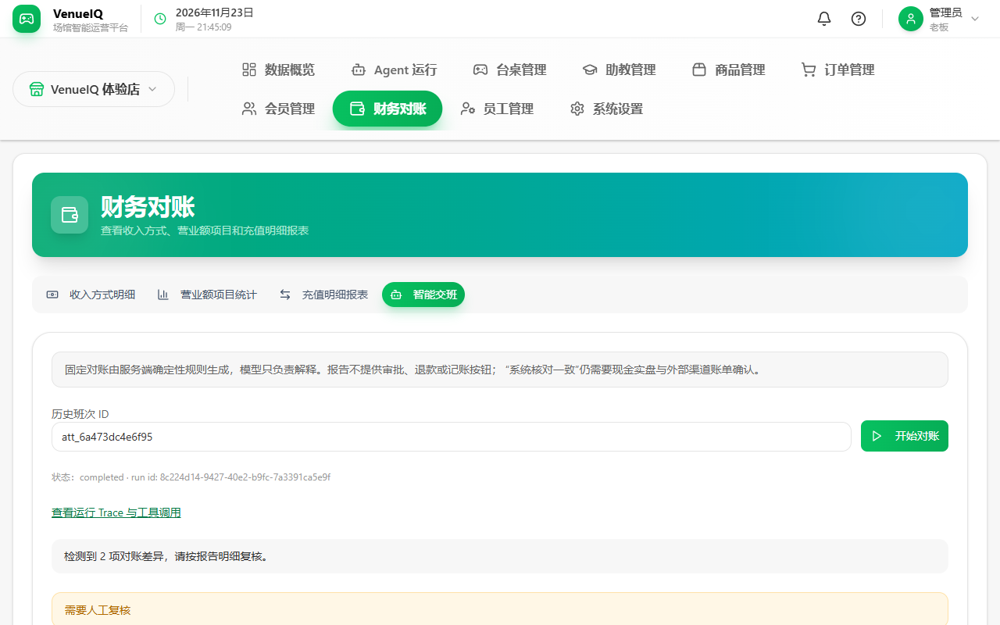 | 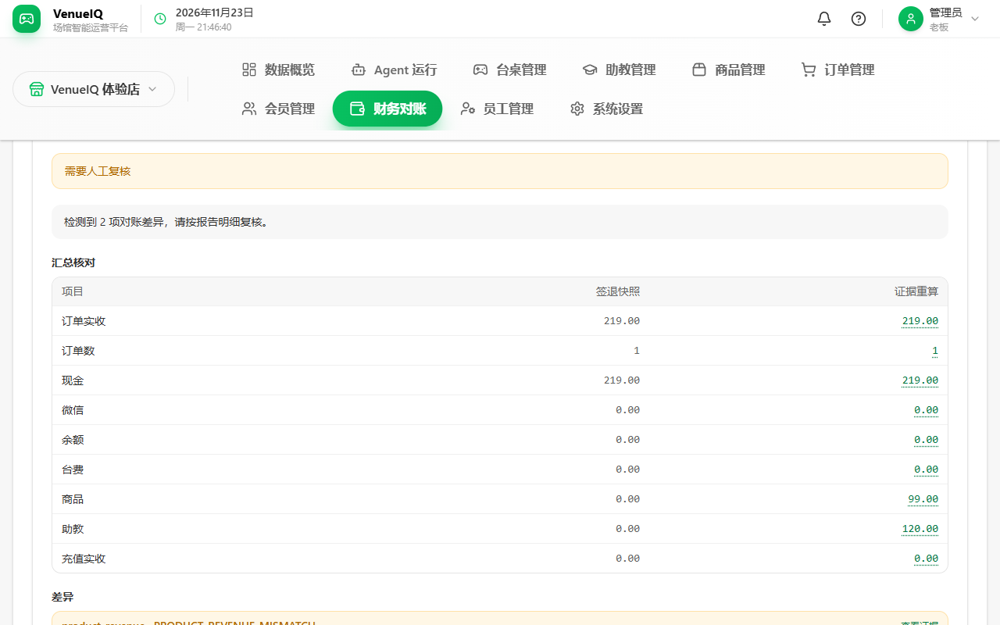 |

| Agent run trace | SOP question answering |
| --- | --- |
| 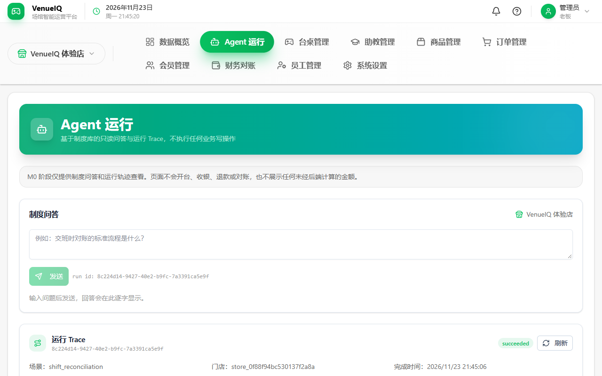 | 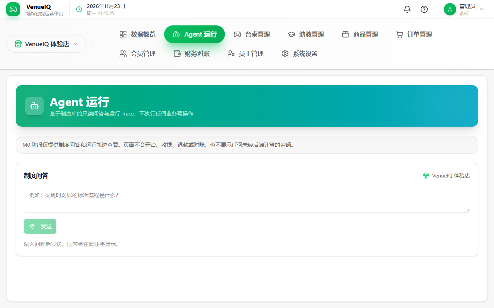 |

| Dashboard | Orders |
| --- | --- |
| 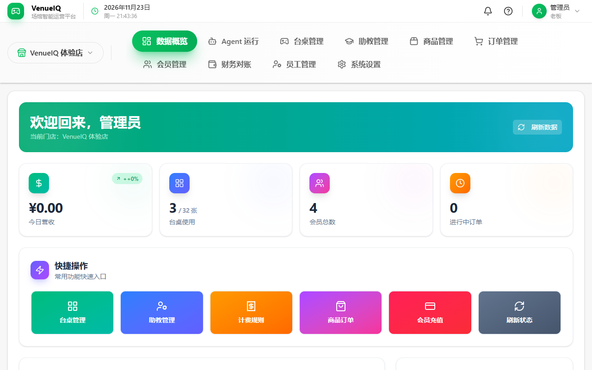 | 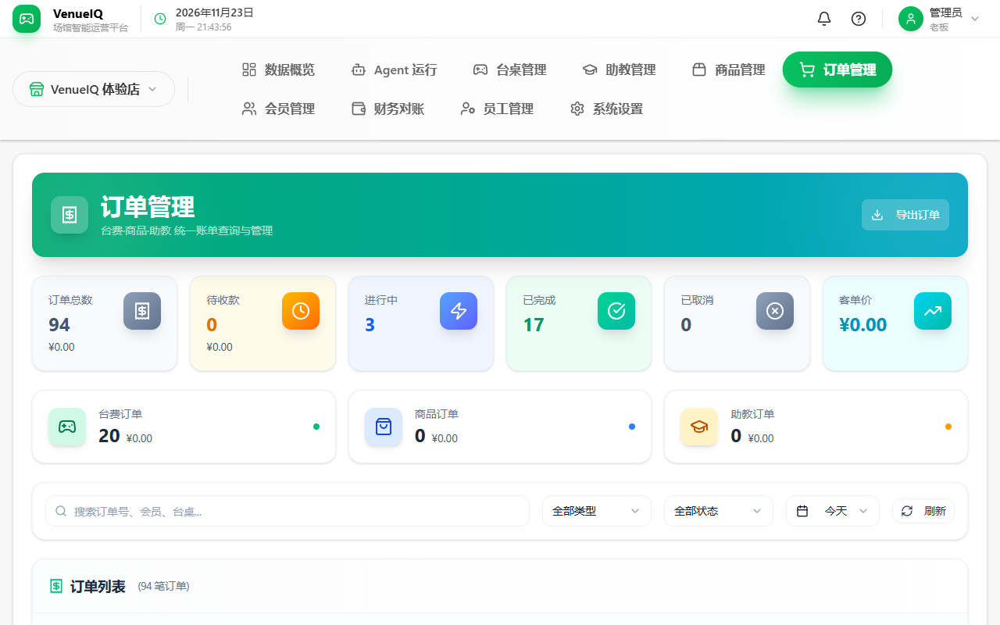 |

More screenshots: [login](docs/screenshots/admin-web/login.png),
[finance](docs/screenshots/admin-web/finance.png),
[tables](docs/screenshots/admin-web/tables.png),
[products](docs/screenshots/admin-web/products.png),
[members](docs/screenshots/admin-web/members.png),
[employees](docs/screenshots/admin-web/employees.png),
[assistants](docs/screenshots/admin-web/assistants.png),
[reports](docs/screenshots/admin-web/reports.png).

### POS terminal

`apps/pos-web` is the cashier terminal for 16:9 touch screens: open and close tables, add products
and assistants, take split payments, and hand over shifts.

| Sign in | Choose store |
| --- | --- |
| 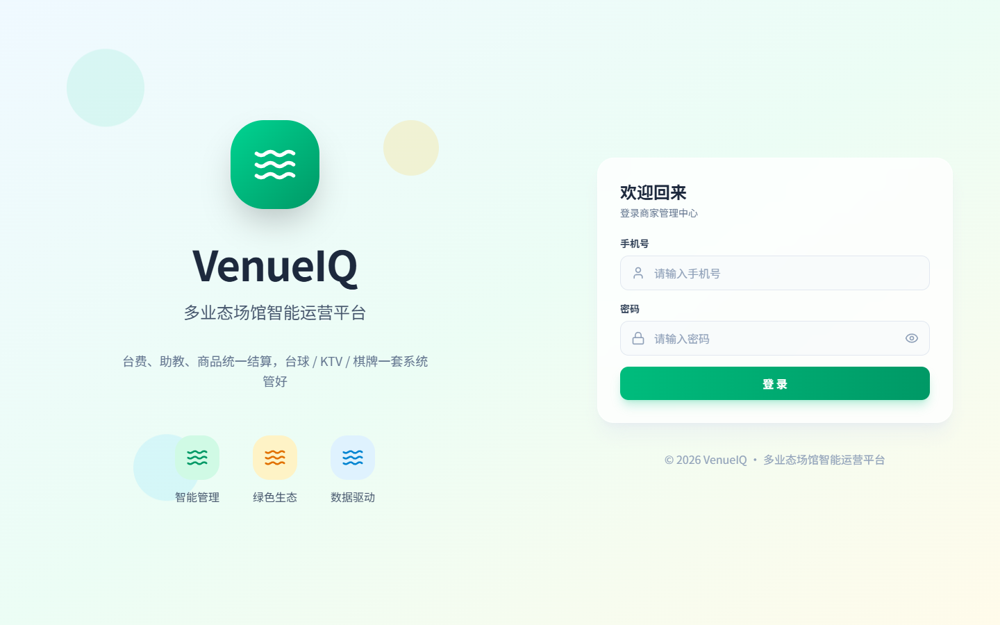 | 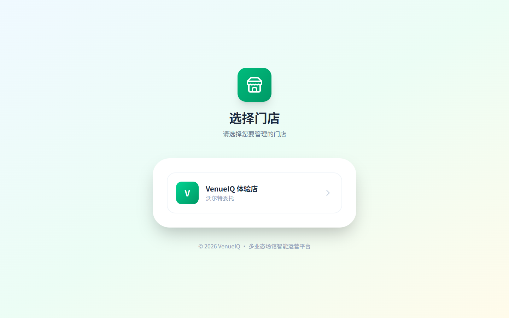 |

| Cashier board | Open table |
| --- | --- |
| 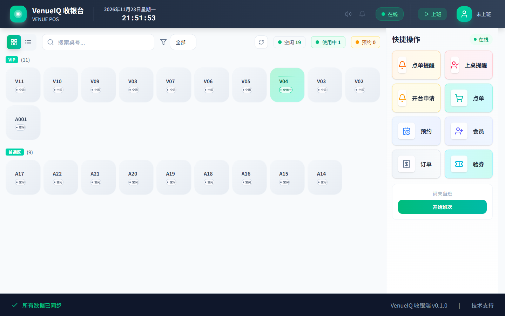 | 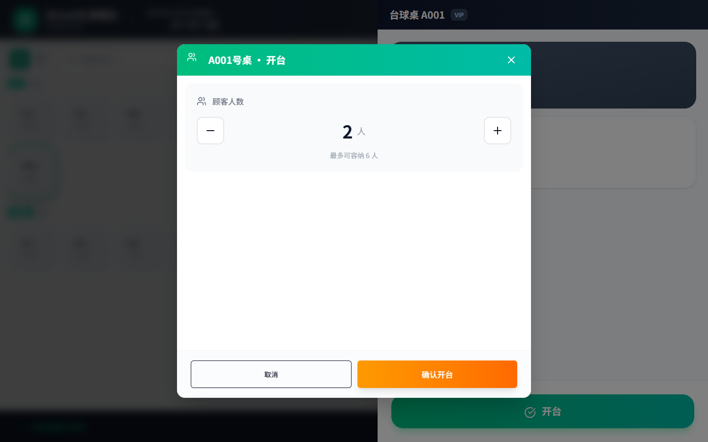 |

### Mobile staff app

`apps/mobile-web` is a uni-app build that runs as a WeChat mini program and as H5. Screenshots below
are captured from the H5 build at a 390×844 viewport, signed in as the demo manager.

| Sign in | Store overview |
| --- | --- |
| 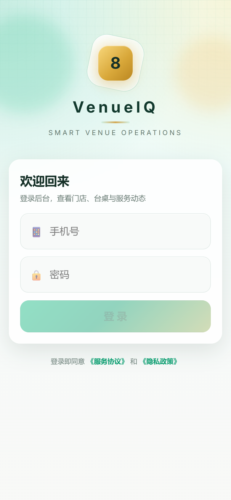 | 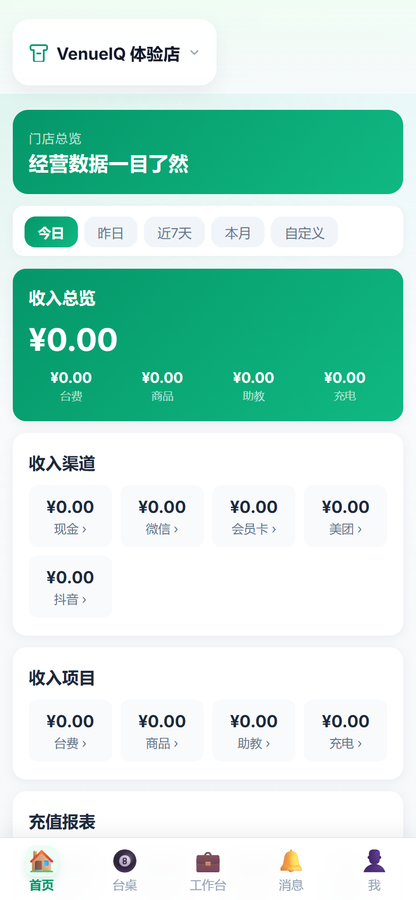 |

| Workbench | Table board |
| --- | --- |
| 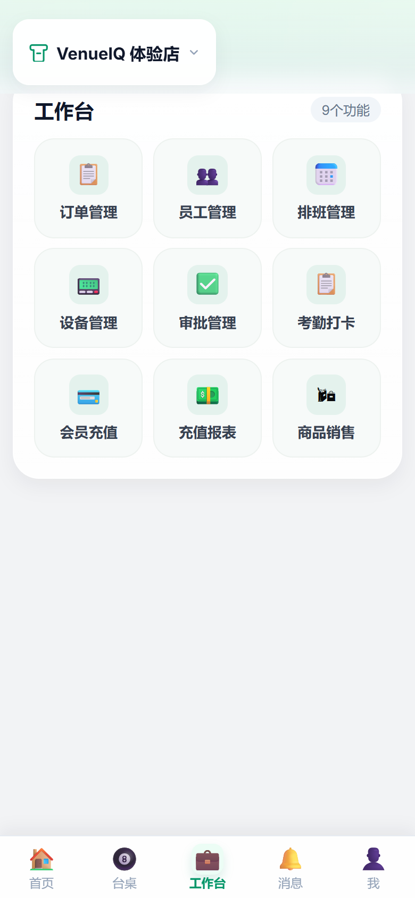 | 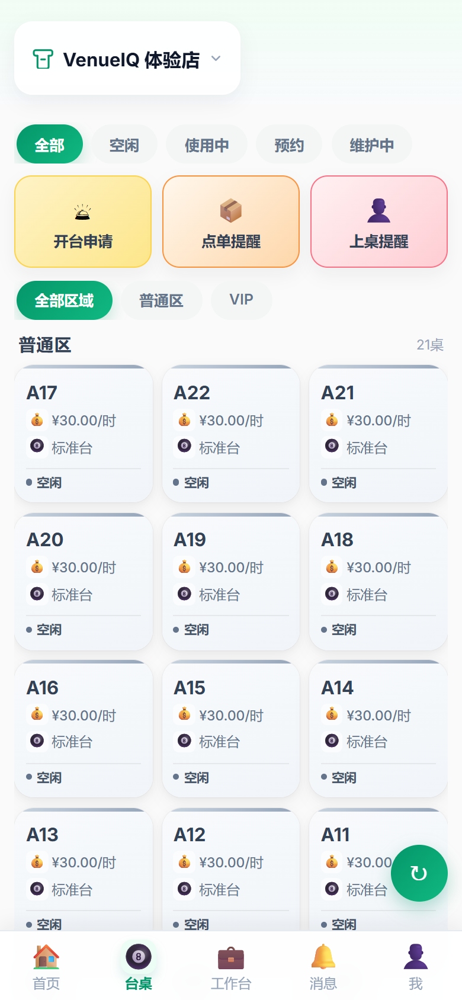 |

| Orders | Attendance |
| --- | --- |
| 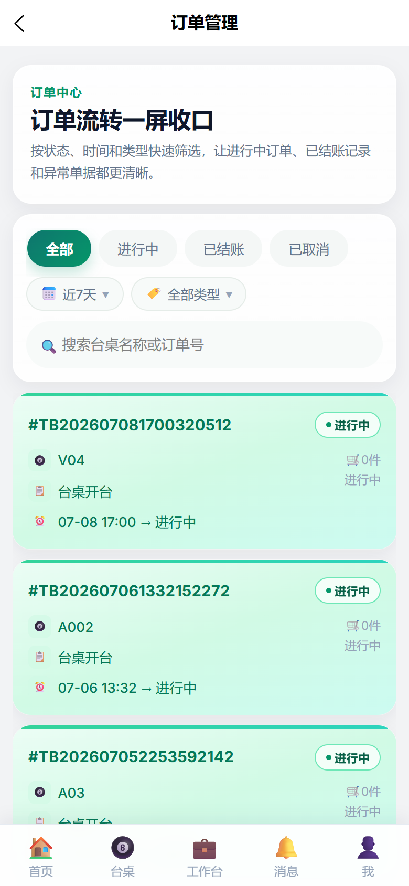 | 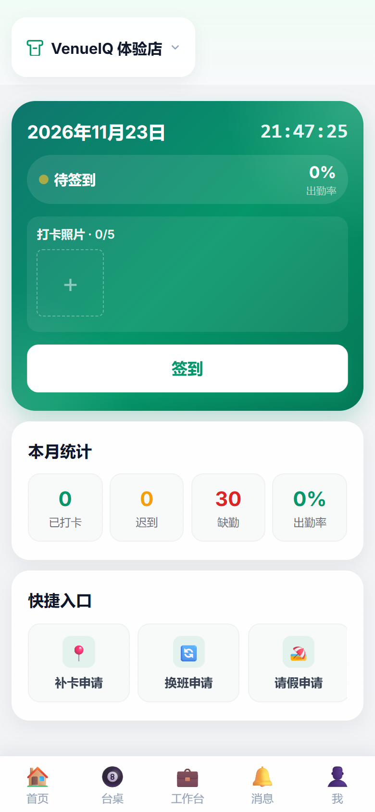 |

More mobile screenshots: [monthly dashboard](docs/screenshots/mobile-web/home-month.png),
[approvals](docs/screenshots/mobile-web/approval.png),
[notifications](docs/screenshots/mobile-web/notification.png),
[schedules](docs/screenshots/mobile-web/schedule.png),
[team](docs/screenshots/mobile-web/employees.png),
[performance](docs/screenshots/mobile-web/performance.png),
[profile](docs/screenshots/mobile-web/profile.png),
[settings](docs/screenshots/mobile-web/settings.png).

## Repository layout

```text
services/agent            FastAPI + LangGraph: reconciliation, analysis, knowledge
services/knowledge-base   RAG service: ingestion, hybrid retrieval, chat streaming
apps/admin-web            Next.js admin console
apps/api                  ThinkPHP business API and reconciliation evidence
apps/pos-web              Point of sale terminal
apps/tablet-web           Table screen application
apps/mobile-web           Mobile staff application
apps/realtime-gateway     WebSocket gateway
benchmarks                Golden datasets and evaluation runners
deploy                    Compose, MySQL init, nginx and systemd units
docs                      Architecture, guides, reference, ADRs, screenshots
```

## Quickstart

```bash
git clone https://github.com/dengyouming163/billiards-ai.git
cd billiards-ai
docker compose -f deploy/docker/compose.test.yml up -d

cd services/agent
python -m venv .venv
source .venv/bin/activate          # Windows: .venv\Scripts\activate
pip install -e ".[dev]"
cp .env.example .env
uvicorn app.main:app --host 127.0.0.1 --port 8100
```

The full path, including the knowledge base and the console, is in
[docs/guides/quickstart.md](docs/guides/quickstart.md).

## Quality gates

| Check | Command | Expected |
| --- | --- | --- |
| Agent tests | `cd services/agent && python -m pytest -q` | 204 passed |
| Frontend types | `cd apps/admin-web && pnpm run ts-check` | no errors |
| Frontend tests | `cd apps/admin-web && pnpm exec vitest run` | 13 passed |
| Reconciliation benchmark | `python benchmarks/run_reconciliation_eval.py` | exact match on all cases |
| SQL security benchmark | `python benchmarks/run_sql_security_eval.py` | every attack rejected |
| Business API | `cd apps/api && php vendor/bin/phpunit --testsuite Integration` | 25 passed |

See [evaluation](docs/guides/evaluation.md) for what each gate is protecting.

## Documentation

| Document | Purpose |
| --- | --- |
| [Architecture](docs/architecture/overview.md) | Component boundaries and request lifecycle |
| [Use cases](docs/architecture/use-cases.md) | Venue types, shared billing primitives, how differences arise |
| [Agent](docs/architecture/agent.md) | Graph nodes, narrative contract, failure modes |
| [Knowledge base](docs/architecture/rag.md) | Retrieval contract, ACL, ingestion |
| [Security](docs/architecture/security.md) | Identity, SQL guard, prompt injection |
| [API reference](docs/reference/api.md) | Requests, responses and error codes |
| [Quickstart](docs/guides/quickstart.md) | Run everything locally |
| [Local development](docs/guides/local-dev.md) | Ports, env files, troubleshooting |
| [Evaluation](docs/guides/evaluation.md) | Datasets and quality gates |
| [ADRs](docs/adr/) | Why reconciliation is deterministic, why SQL is doubly guarded, why retrieval degrades |

## Roadmap

- Streaming narrative rendering for long explanations.
- Retrieval quality dashboard fed by the existing trace records.
- Additional analysis views, each with its grant and allowlist entry in the same change.
- Pluggable model provider with a per-tenant budget.

## Contributing

See [CONTRIBUTING.md](CONTRIBUTING.md) and [CODE_OF_CONDUCT.md](CODE_OF_CONDUCT.md). Security issues
must be reported privately, see [SECURITY.md](SECURITY.md).

## License

[Apache-2.0](LICENSE)
