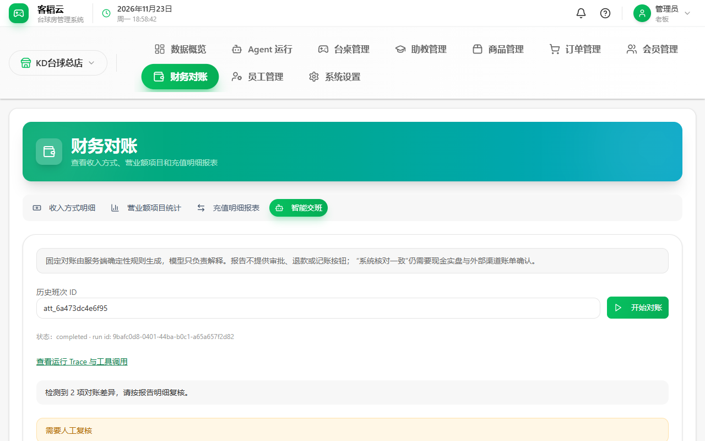
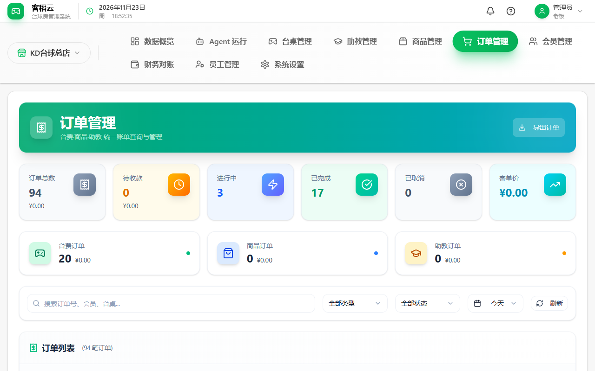

# billiards-ai

**面向台球门店的 AI 运营层：确定性交班对账、只读 SQL 分析、基于 RAG 的制度检索。**

[English](README.md) · [架构说明](docs/architecture/overview.md) · [快速开始](docs/guides/quickstart.md) · [API 参考](docs/reference/api.md)

[](https://github.com/dengyouming163/billiards-ai/actions/workflows/agent-ci.yml)
[](https://github.com/dengyouming163/billiards-ai/actions/workflows/web-ci.yml)
[](LICENSE)

---

## 为什么做这个项目

店长交班时同时需要三件事：**数字必须准确**、**差异必须能解释**、**处置必须依据制度**。

常见的做法是把三件事都塞进一个对话框。本项目刻意把它们分开：

| 要求 | 实现方式 | 模型可以做什么 |
| --- | --- | --- |
| 数字必须准确 | 确定性规则比对签退快照与重算证据 | 不做任何计算 |
| 数据不能被修改 | SQL AST 白名单 + 只读账号 + 行数与超时限制 | 只能提出查询，由守卫校验 |
| 处置必须可溯源 | 混合检索 + 租户与文档级 ACL | 只能引用本次真实召回的片段 |

模型变慢、出错或不可用时，报告依然生成，只是被标记为 `degraded`，并在界面明确提示说明缺失——**金额永远不会因此改变**。

## 能力矩阵

| 能力 | 接口 | 保证 |
| --- | --- | --- |
| 交班对账 | `POST /v1/reconciliation/runs/stream` | 数值由规则计算，每个值可回溯到证据来源 |
| 对账追问 | `POST /v1/reconciliation/runs/{id}/messages/stream` | 只基于已保存报告回答 |
| 只读 SQL 分析 | `POST /v1/analysis/runs/stream` | 单条 `SELECT`、视图白名单、强制门店作用域、被拒绝即不执行 |
| 制度问答 | `POST /v1/knowledge/runs/stream` | 引用必须出现在本次召回结果中 |
| 运行轨迹 | `GET /v1/runs/{id}` | 可回放工具调用、事件与结果 |

## 架构

```text
┌─────────────────────────────┐
│ apps/admin-web (Next.js 16) │  财务对账 · 运行轨迹 · 制度问答
└──────────────┬──────────────┘
               │ Bearer Token
┌──────────────▼──────────────┐        ┌─────────────────────────────┐
│ apps/api (ThinkPHP 8)       │◄───────┤ agent.Auth/context          │
│ 门店隔离的业务数据           │        │ 解析租户、门店、角色         │
└──────────────┬──────────────┘        └──────────────▲──────────────┘
               │ 对账证据                             │ 身份
┌──────────────▼──────────────────────────────────────┴──────────────┐
│ services/agent (FastAPI + LangGraph)                               │
│  对账图 │ 分析图 │ 知识问答图                                       │
│  守卫：身份、SQL AST 白名单、门店作用域、行数与超时                  │
└──────────┬──────────────────────────────┬──────────────────────────┘
           │ 只读账号 SQL                  │ POST /v1/kbs/{id}/search
┌──────────▼────────────┐      ┌──────────▼──────────────────────────┐
│ MySQL（业务库）        │      │ services/knowledge-base (FastAPI)    │
│ 仅暴露分析视图         │      │ PostgreSQL + pgvector + BM25 + RRF   │
└───────────────────────┘      └─────────────────────────────────────┘
```

深入阅读：

- [架构总览](docs/architecture/overview.md)
- [对账 Agent](docs/architecture/agent.md)：节点流、说明合约、降级语义
- [知识库](docs/architecture/rag.md)：混合检索、ACL、租户隔离
- [安全模型](docs/architecture/security.md)：身份、SQL 守卫分层、提示注入防护

## 演示环境

| 服务 | 地址 | 说明 |
| --- | --- | --- |
| 管理后台 | http://132.232.166.40/ | 使用下方演示账号登录 |
| 业务 API | http://132.232.166.40/storeapi | ThinkPHP JSON 接口 |
| Agent API | http://132.232.166.40/agent/docs | OpenAPI 文档 |
| 知识库 | http://132.232.166.40/rag/docs | 检索与问答接口 |

演示账号：`18085092430` / `123456`

该环境为单机演示部署，使用测试数据，可能随时重置，不得用于生产流量或存放机密资料。上报方式见 [SECURITY.md](SECURITY.md)。

## 界面截图

| 交班对账 | 汇总与差异明细 |
| --- | --- |
|  |  |

| 运行轨迹 | 制度问答 |
| --- | --- |
|  |  |

| 首页仪表盘 | 订单管理 |
| --- | --- |
|  |  |

更多截图：[登录](docs/screenshots/admin-web/login.png)、
[财务对账](docs/screenshots/admin-web/finance.png)、
[台桌](docs/screenshots/admin-web/tables.png)、
[商品](docs/screenshots/admin-web/products.png)、
[会员](docs/screenshots/admin-web/members.png)、
[员工](docs/screenshots/admin-web/employees.png)、
[助教](docs/screenshots/admin-web/assistants.png)、
[报表](docs/screenshots/admin-web/reports.png)。

## 目录结构

```text
services/agent            FastAPI + LangGraph：对账、分析、知识问答
services/knowledge-base   RAG 服务：入库、混合检索、流式问答
apps/admin-web            Next.js 管理后台
apps/api                  ThinkPHP 业务 API 与对账证据接口
apps/pos-web              收银台
apps/tablet-web           台桌屏
apps/mobile-web           移动端员工端
apps/realtime-gateway     WebSocket 网关
benchmarks                金标数据集与评测脚本
deploy                    Compose、MySQL 初始化、nginx 与 systemd
docs                      架构、指南、参考、ADR、截图
```

## 快速开始

```bash
git clone https://github.com/dengyouming163/billiards-ai.git
cd billiards-ai
docker compose -f deploy/docker/compose.test.yml up -d

cd services/agent
python -m venv .venv
source .venv/bin/activate          # Windows: .venv\Scripts\activate
pip install -e ".[dev]"
cp .env.example .env
uvicorn app.main:app --host 127.0.0.1 --port 8100
```

包含知识库与管理后台的完整流程见 [docs/guides/quickstart.md](docs/guides/quickstart.md)。

## 质量门禁

| 检查项 | 命令 | 预期 |
| --- | --- | --- |
| Agent 测试 | `cd services/agent && python -m pytest -q` | 204 passed |
| 前端类型 | `cd apps/admin-web && pnpm run ts-check` | 无错误 |
| 前端测试 | `cd apps/admin-web && pnpm exec vitest run` | 13 passed |
| 对账评测 | `python benchmarks/run_reconciliation_eval.py` | 全部用例精确匹配 |
| SQL 安全评测 | `python benchmarks/run_sql_security_eval.py` | 全部攻击被拒绝 |
| 业务 API | `cd apps/api && php vendor/bin/phpunit --testsuite Integration` | 25 passed |

每道门禁在保护什么，见 [评测指南](docs/guides/evaluation.md)。

## 文档索引

| 文档 | 内容 |
| --- | --- |
| [架构总览](docs/architecture/overview.md) | 组件边界与请求生命周期 |
| [Agent](docs/architecture/agent.md) | 节点、说明合约、失败模式 |
| [知识库](docs/architecture/rag.md) | 检索契约、ACL、入库流程 |
| [安全模型](docs/architecture/security.md) | 身份、SQL 守卫、提示注入 |
| [API 参考](docs/reference/api.md) | 请求、响应与错误码 |
| [快速开始](docs/guides/quickstart.md) | 本地跑通全链路 |
| [本地开发](docs/guides/local-dev.md) | 端口、环境文件、常见问题 |
| [评测](docs/guides/evaluation.md) | 数据集与质量门禁 |
| [ADR](docs/adr/) | 为什么数值确定性、为什么双层 SQL 防护、为什么检索失败只降级 |

## 路线图

- 长文本说明的流式渲染。
- 基于既有 trace 记录构建检索质量看板。
- 新增分析视图时，在同一变更内补齐授权与白名单。
- 可插拔模型供应商与按租户的预算控制。

## 参与贡献

请阅读 [CONTRIBUTING.md](CONTRIBUTING.md) 与 [CODE_OF_CONDUCT.md](CODE_OF_CONDUCT.md)。安全问题请按 [SECURITY.md](SECURITY.md) 私下上报。

## 许可

[Apache-2.0](LICENSE)
